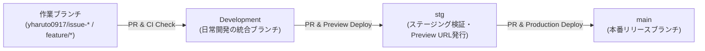
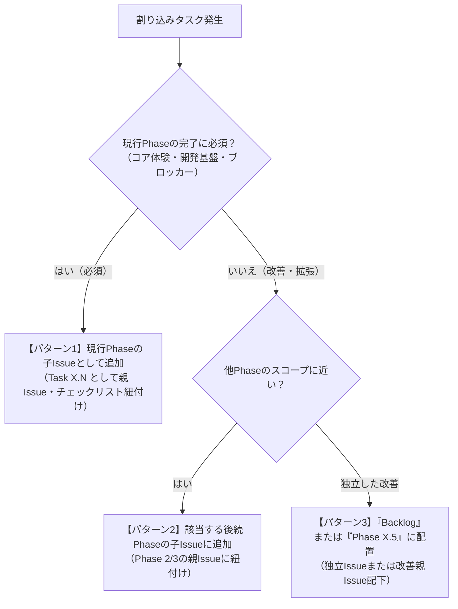

# カプセルタスク（Capsule Tasks）AIエージェント開発ガイドライン

本ドキュメントは、AIエージェントおよび開発者が『カプセルタスク（仮）』の開発を円滑に進めるための運用規約・ブランチ戦略・DevOpsフローを定義します。

---

## 1. 開発フロー・基本原則

### 1.1 品質管理とワークフロー
* **テスト・フォーマッター・リンターの通過必須**: コード変更後は必ずテスト（`npm test`）・型チェック（`npx tsc --noEmit`）・フォーマッター・リンター（`npm run lint`）・ビルド（`npm run build`）を実行し、すべてのチェックを通過させてください。
* **ブラウザによるUI検証**: フロントエンドUI（Vite + React）の作成・修正時は、必ず実機相当のモバイルビューポート（320px〜430px）にてブラウザ表示・アニメーション・レスポンシブ動作を確認してください。

### 1.2 命名規則
* **ファイル名**:
  * TypeScript / React: `kebab-case.tsx` / `kebab-case.ts`（例: `capsule-stage.tsx`, `use-capsule-store.ts`, `tasks-extract.ts`）
  * Python（スクリプト等）: `snake_case.py`
* **コンポーネント名**: `PascalCase`（例: `CapsuleStage`, `TaskSupplySheet`, `MedalRevealModal`）
* **カスタムフック名**: `useCamelCase`（例: `useCapsuleStore`, `useMedalStorage`, `useSoundEffect`）

### 1.3 ブランチ戦略（3階層フロー）＆ Worktree 運用



* **3つの永続ブランチと役割**:
  1. **`Development` ブランチ（日常開発の統合先）**:
     * 各タスク・Issueの作業ブランチ（`yharuto0917/issue-{番号}-{概要}` または `feature/*`）は、`Development` から分岐し、**必ず `Development` ブランチへ向けてPRを作成**してください（`main` へ直接機能PRを出さないこと）。
  2. **`stg` ブランチ（ステージング検証＆Cloudflare Workers Preview URL）**:
     * `Development` で統合された機能をステージング検証する際、`Development` → `stg` へのPRを作成・マージします。
     * `stg` へのPushおよびPR作成時には GitHub Actions（`deploy-stg-preview.yml`）が自動実行され、**Cloudflare Workers の Preview URL**（`https://stg-capsule-tasks.<subdomain>.workers.dev` およびバージョン固有 Preview URL）が発行されてPRコメント・Job Summaryに出力されます。
     * 本番リリース前に必ずこの Preview URL 上で実機動作確認を行います。
  3. **`main` ブランチ（本番環境）**:
     * `stg` の Preview URL で動作確認が完了した変更のみを、`stg` → `main` のPRでマージします。
     * `main` へのマージ時に GitHub Actions（`deploy-production.yml`）により Cloudflare Workers 本番環境（`capsule-tasks`）へ自動デプロイされます。
* **Worktreeの活用とブランチ削除**:
  * 原則として作業ごとに独立した Worktree（`/Users/yharuto/Documents/programing/orca/capsule-tasks/issue-{番号}-{概要}`）を切り、コンテキストの汚染を防ぎます。
  * PRがマージされたなど、使用が終了した作業ブランチおよびWorktreeは速やかに削除してください（`Development`, `stg`, `main` は永続ブランチのため削除しないこと）。

### 1.4 コミットメッセージ規約
* すべて日本語で記述してください。
* 変更内容を簡潔に要約し、「なぜ変更したか」の理由を明記してください。
* コミットメッセージ末尾に実行したモデル名を記載してください。
  ```text
  docs(agents): 割り込みタスク発生時のIssue配置・運用ルールをAGENTS.mdに策定

  開発進行中に発生する改善や仕様変更の取り扱い基準を明確化し、
  スコープ管理とGitHub Issues/Projectの同期運用を統一するため。

  Co-Authored by Gemini 4 Argon
  ```

### 1.5 プルリクエスト（PR）規約
* `.github/PULL_REQUEST_TEMPLATE.md` に従い、変更内容を詳細かつ簡潔な箇条書きで記述してください。
* 変更理由（なぜこの変更が必要だったか、前の実装の何が良くなかったか）を明確に説明してください。
* 関連するIssue番号（`Closes #21` 等）とターゲットブランチ（通常は `Development`）を明記してください。

### 1.6 注意事項
* `.env`, `.env.example`, `.dev.vars` などの環境変数ファイルはコミット・変更しないでください。
* 本番環境の設定ファイルを変更する場合は、必ずユーザーの事前確認を取ってください。

---

## 2. 割り込みタスク発生時のIssue配置・運用ルール（制約）

開発進行中に、追加要件、UI改善、仕様変更、インフラ整備、リファクタリングなどの割り込みタスクが発生した場合は、以下の判断フローに従ってIssueを作成・配置してください。



### 2.1 パターン1: 現行Phaseの完了に必須な場合（Must-Have for Phase）
* **適用基準**:
  * 現行Phaseのゴール（例: Phase 1 MVPの「触って気持ちいいカプセル開封体験」や「安全なステージング・CI/CD開発基盤」）を満たすために必須の改善・修正・基盤整備
  * 後回しにすると後続タスクの手戻りが大きくなるもの
* **配置場所**: **現行Phaseの親Issue配下（子Issue）**
* **運用ルール**:
  1. 命名規則: `[Task {Phase番号}.{連番}] {内容}`（例: `[Task 1.9] 開発・ステージング環境（Development / stg ブランチ）と Cloudflare Workers Preview / CI-CD（DevOps）の構築`）
  2. GitHub Sub-issues APIを用いて現行Phaseの親Issueの子Issueとして登録する。
  3. 親Issue本文内の「子Issue（実装タスク一覧）」チェックリストに `- [ ] #{Issue番号} ...` を追記する。
  4. GitHub Project（#3）に対象アイテムとして即時追加する。

### 2.2 パターン2: 後続Phaseに組み込むのが自然な場合（Next Phase Scope）
* **適用基準**:
  * 現行Phaseの完了には必須ではないが、後続Phaseの機能と密接に関連する改善・拡張
* **配置場所**: **関連する後続Phase（Phase 2 または 3）の親Issue配下（子Issue）**
* **運用ルール**:
  1. 該当Phaseの末尾連番（`Task 2.N` または `Task 3.N`）として子Issueを作成する。
  2. 対象Phaseの親IssueにSub-issueとして紐付け、チェックリストに追記する。
  3. GitHub Project（#3）に追加する。

### 2.3 パターン3: 独立した改善・技術的負債・アイデア（Backlog / Polish）
* **適用基準**:
  * MVPの進行を阻害せず、余力がある際やPhase完了後の隙間に対応したいリファクタリング、細かな調整、アイデア
* **配置場所**: **Phaseに属さない独立Issue、または改善専用親Issue配下**
* **運用ルール**:
  1. ラベルに `polish` または `backlog` を付与する。
  2. GitHub Project（#3）の `Status: Backlog`（または `Icebox`）に配置する。

---

## 3. Issue作成・更新時のチェックリスト

新しくIssueを起票、または割り込みタスクを追加する際は、以下を必ず実施してください。

- [ ] タイトルが `[Phase X] ...` または `[Task X.N] ...` の規約に沿っていること
- [ ] 本文に `Parent Issue: #X`、「概要」「対応要件」「詳細実装内容」「受け入れ条件」「想定変更ファイル」が網羅されていること
- [ ] 親Issueが存在する場合、Sub-issueとして紐付けられていること
- [ ] 親Issue本文のチェックリストに該当Issueが追加されていること
- [ ] GitHub Project（#3）に登録されていること
- [ ] 実装計画書（`tasks/plan.md`）およびチェックリスト（`tasks/todo.md`）に反映されていること

---

## 4. Cloudflare Workers Preview URL（stg）＆ CI/CD 仕様

### 4.1 `wrangler.jsonc` の必須設定
Cloudflare Workers の Preview URL 機能および `stg` 環境デプロイを有効にするため、`wrangler.jsonc` には必ず `"workers_dev": true`, `"preview_urls": true`, および `"env.staging"` を含めてください。

```jsonc
{
  "$schema": "node_modules/wrangler/config-schema.json",
  "name": "capsule-tasks",
  "main": "src/server/index.ts",
  "compatibility_date": "2026-10-01",
  "compatibility_flags": ["nodejs_compat"],
  "workers_dev": true,
  "preview_urls": true,
  "assets": {
    "not_found_handling": "single-page-application",
    "binding": "ASSETS",
    "run_worker_first": ["/api/*"]
  },
  "env": {
    "staging": {
      "name": "capsule-tasks-stg",
      "workers_dev": true,
      "preview_urls": true
    }
  }
}
```

### 4.2 GitHub Actions ワークフローと必要な GitHub Secrets
| ワークフロー | トリガー | 役割 |
| :--- | :--- | :--- |
| `.github/workflows/ci.yml` | `Development`, `stg`, `main` への Push / PR | Lint, Typecheck, Unit Test, Build, Security Audit の品質ゲート |
| `.github/workflows/deploy-stg-preview.yml` | `stg` への Push / `stg`・`main` 向け PR | `wrangler versions upload --preview-alias stg`（および `env.staging`）を実行し、発行された **Preview URL** を PR コメント＆ Job Summary に自動投稿 |
| `.github/workflows/deploy-production.yml` | `main` への Push | 品質チェック通過後に `wrangler deploy` で本番環境へデプロイ |

* **GitHub Repository Secrets 設定項目**:
  * `CLOUDFLARE_API_TOKEN`: Cloudflare Workers の編集・デプロイ権限を持つ API トークン
  * `CLOUDFLARE_ACCOUNT_ID`: Cloudflare アカウント ID
  * （Cloudflare Worker 側の Secret として `wrangler secret put GEMINI_API_KEY` を設定）
