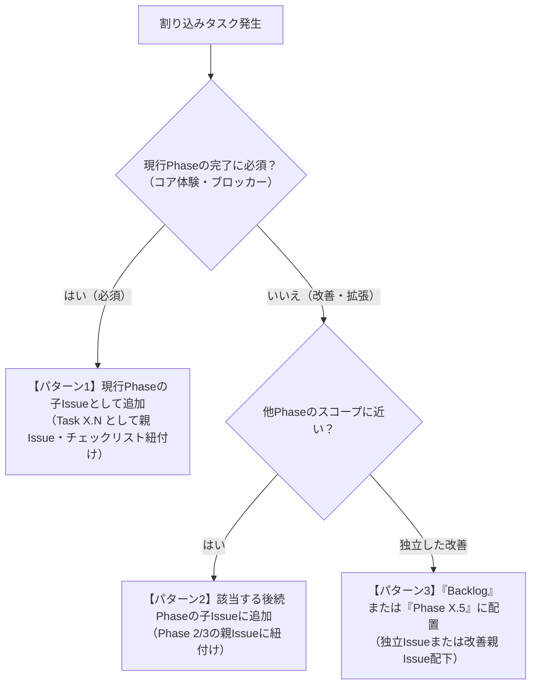

# カプセルタスク（Capsule Tasks）AIエージェント開発ガイドライン

本ドキュメントは、AIエージェントおよび開発者が『カプセルタスク（仮）』の開発を円滑に進めるための運用規約・開発フローを定義します。

---

## 1. 開発フロー・基本原則

### 1.1 品質管理とワークフロー
* **テスト・フォーマッター・リンターの通過必須**: コード変更後は必ずテスト・フォーマッター・リンターを実行し、すべてのチェックを通過させてください。
* **ブラウザによるUI検証**: フロントエンドUI（Vite + React）の作成・修正時は、必ず実機相当のモバイルビューポート（320px〜430px）にてブラウザ表示・アニメーション・レスポンシブ動作を確認してください。

### 1.2 命名規則
* **ファイル名**:
  * TypeScript / React: `kebab-case.tsx` / `kebab-case.ts`（例: `capsule-stage.tsx`, `use-capsule-store.ts`, `tasks-extract.ts`）
  * Python（スクリプト等）: `snake_case.py`
* **コンポーネント名**: `PascalCase`（例: `CapsuleStage`, `TaskSupplySheet`, `MedalRevealModal`）
* **カスタムフック名**: `useCamelCase`（例: `useCapsuleStore`, `useMedalStorage`, `useSoundEffect`）

### 1.3 ブランチ戦略＆Worktree運用
* **機能実装・修正時のブランチ作成**: 機能追加、不具合修正、リファクタリング、ドキュメント追加などの変更は必ず作業用ブランチを作成してください。
* **Worktreeの活用**: 原則として作業ごとに独立したWorktreeを切り、コンテキストの汚染を防ぎます。
* **ブランチの削除**: PRがマージされたなど、使用が終了したブランチは速やかに削除してください。

### 1.4 コミットメッセージ規約
* すべて日本語で記述してください。
* 変更内容を簡潔に要約し、「なぜ変更したか」の理由を明記してください。
* コミットメッセージ末尾に実行したモデル名を記載してください。
  ```text
  docs(agents): 割り込みタスク発生時のIssue配置・運用ルールをAGENTS.mdに策定

  開発進行中に発生する改善や仕様変更の取り扱い基準を明確化し、
  スコープ管理とGitHub Issues/Projectの同期運用を統一するため。

  Co-Authored by Gemini 3.8 Flash
  ```

### 1.5 プルリクエスト（PR）規約
* PR本文には変更内容をなるべく詳細に、ただし冗長にならず箇条書きで記述してください。
* 変更理由（なぜこの変更が必要だったか、変更前はどうだったか）を明確に説明してください。
* 関連するIssue番号（`Closes #19` 等）を明記してください。

### 1.6 注意事項
* `.env`, `.env.example`, `.dev.vars` などの環境変数ファイルはコミット・変更しないでください。
* 本番環境の設定ファイルを変更する場合は、必ずユーザーの事前確認を取ってください。

---

## 2. 割り込みタスク発生時のIssue配置・運用ルール（制約）

開発進行中に、追加要件、UI改善、仕様変更、リファクタリングなどの割り込みタスクが発生した場合は、以下の判断フローに従ってIssueを作成・配置してください。



### 2.1 パターン1: 現行Phaseの完了に必須な場合（Must-Have for Phase）
* **適用基準**:
  * 現行Phaseのゴール（例: Phase 1 MVPの「触って気持ちいいカプセル開封体験」）を満たすために必須の改善・修正
  * 後回しにすると後続タスクの手戻りが大きくなるもの
* **配置場所**: **現行Phaseの親Issue配下（子Issue）**
* **運用ルール**:
  1. 命名規則: `[Task {Phase番号}.{連番}] {内容}`（例: `[Task 1.7] ガチャ演出・カプセル質感・マイクロインタラクション等のUI/UX改善と演出強化`）
  2. GitHub Sub-issues API（またはCLI）を用いて現行Phaseの親Issueの子Issueとして登録する。
  3. 親Issue本文内の「子Issue（実装タスク一覧）」チェックリストに `- [ ] #{Issue番号} ...` を追記する。
  4. GitHub Project（#3）に対象アイテムとして即時追加する。

### 2.2 パターン2: 後続Phaseに組み込むのが自然な場合（Next Phase Scope）
* **適用基準**:
  * 現行Phaseの完了には必須ではないが、後続Phaseの機能と密接に関連する改善・拡張
  * 例: 「タイマー稼働中の画面エフェクト改善」→ Phase 2（放置タイマー）に追加
* **配置場所**: **関連する後続Phase（Phase 2 または 3）の親Issue配下（子Issue）**
* **運用ルール**:
  1. 該当Phaseの末尾連番（`Task 2.N` または `Task 3.N`）として子Issueを作成する。
  2. 対象Phaseの親IssueにSub-issueとして紐付け、チェックリストに追記する。
  3. GitHub Project（#3）に追加する。現行Phaseの進行を遅らせずにスコープを整理する。

### 2.3 パターン3: 独立した改善・技術的負債・アイデア（Backlog / Polish）
* **適用基準**:
  * MVPの進行を阻害せず、余力がある際やPhase完了後の隙間に対応したいリファクタリング、細かな調整、アイデア
* **配置場所**: **Phaseに属さない独立Issue、または改善専用親Issue配下**
* **運用ルール**:
  1. ラベルに `polish` または `backlog` を付与する。
  2. GitHub Project（#3）の `Status: Backlog`（または `Icebox`）に配置する。
  3. 現行Phaseのマイルストーン完了後に着手判断を行う。

---

## 3. Issue作成・更新時のチェックリスト

新しくIssueを起票、または割り込みタスクを追加する際は、以下を必ず実施してください。

- [ ] タイトルが `[Phase X] ...` または `[Task X.N] ...` の規約に沿っていること
- [ ] 本文に「概要」「対応要件」「詳細実装内容」「受け入れ条件」「想定変更ファイル」が網羅されていること
- [ ] 親Issueが存在する場合、Sub-issueとして紐付けられていること
- [ ] 親Issue本文のチェックリストに該当Issueが追加されていること
- [ ] GitHub Project（#3）に登録されていること
- [ ] 実装計画書（`tasks/plan.md`）およびチェックリスト（`tasks/todo.md`）に反映されていること
