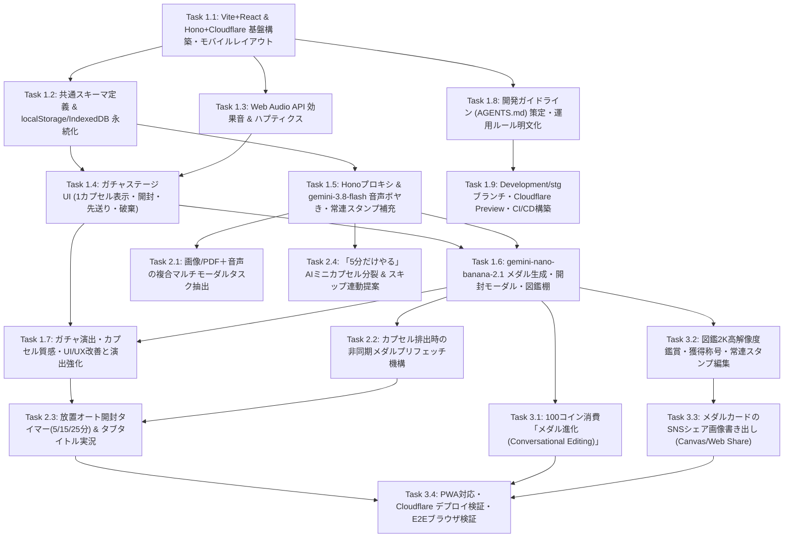

# 実装計画書：カプセルトイ型タスク攻略Webアプリ『カプセルタスク（仮）』

## 1. 概要（Overview）

本計画書は、[task_gacha_requirements.md](file:///Users/yharuto/Documents/programing/capsule-tasks/task_gacha_requirements.md) に基づき、「ToDoリストを廃止し、1個ずつ転がり出るカプセル（タスク）を割ってAI生成のオリジナル記念メダルを集める、スマホ片手完結のカプセルトイ型ゲーム」を構築するための詳細な実装計画を定義する。

従来のタスク管理における「追加がダルい」「完了が面倒」「一覧を見るのがストレス」という3大課題を解決するため、以下のコア体験を実装する。
1. **マルチモーダルタスク補充**：`gemini-3.8-flash`（Interactions API / `thinking_level: "low"` / Structured Outputs）を用い、音声の雑なボヤきや写真＋音声から複数のカプセルタスクへ自動分解・難易度（色）判定・メダルプロンプト生成を行い、即時補充ボーナス（＋10コイン）を付与する。
2. **1画面1カプセル＆罪悪感ゼロの選別**：一覧画面を廃止し、画面中央に1個のカプセルのみを表示。左スワイプで先送り（ガチャを回し直す演出）、ゴミ箱スワイプでリサイクル破棄（＋5コイン）、重いタスクはAIで「5分ミニカプセル」へ分裂させる。
3. **爽快な開封演出＆世界に1つのAI記念メダル**：タップ連打・長押し、または放置タイマー（5/15/25分）でカプセルにヒビが入って割れ、バックグラウンドでプリフェッチ生成された `gemini-nano-banana-2.1` の記念メダル画像（N/R/SR/SSR）を待ち時間ゼロで獲得・コレクションできる。

---

## 2. アーキテクチャ・技術選定（Architecture Decisions）

### 2.1 フロントエンド（Vite + React）・バックエンド（Hono）・Cloudflare デプロイ構成
* **フロントエンド**：**Vite + React + TypeScript + Tailwind CSS**（PWA対応：`vite-plugin-pwa`）
  * **選定理由**：高速なビルド・HMRと、シングルページアプリケーション（SPA）としての超高速な初回描画（1秒以内）を実現し、モバイルファーストの1画面完結UI・Web Audio API・IndexedDB 操作に最適であるため。
* **バックエンド**：**Hono（Cloudflare Workers 上で稼働）**
  * **選定理由**：超軽量・Web Standard 準拠で Cloudflare Workers にネイティブ最適化されており、Hono RPC（`hc<AppType>`）によってフロントエンド（Vite + React）とバックエンド間でエンドツーエンドの型安全なAPI通信を実現できるため。
* **インフラ・デプロイ**：**Cloudflare Workers (Static Assets + Worker API) / Wrangler**
  * `wrangler.jsonc` と `@cloudflare/vite-plugin` を用い、フロントエンドの静的アセット（Viteビルド成果物）と Hono バックエンド（`/api/*`）を単一の Cloudflare Worker 上で同一オリジン配信する。
  * Gemini APIキーは Cloudflare Workers の環境変数（Secret: `c.env.GEMINI_API_KEY`、ローカル開発時は `.dev.vars`）として厳重に管理し、クライアント側には一切露出させない（要件 6 準拠）。
  * `npx wrangler deploy` 1コマンドで Cloudflare エッジネットワークへデプロイ可能な構成とする。
* **命名規約（User Rules準拠）**：
  * ファイル名：`kebab-case.tsx` / `kebab-case.ts`（例：`capsule-stage.tsx`, `use-capsule-store.ts`, `tasks-extract.ts`）
  * コンポーネント名：`PascalCase`（例：`CapsuleStage`, `TaskSupplySheet`, `MedalRevealModal`）
  * カスタムフック名：`useCamelCase`（例：`useCapsuleStore`, `useMedalStorage`, `useSoundEffect`）
* **品質管理・テスト**：
  * ESLint + Prettier によるコード整形・静的解析
  * Vitest + React Testing Library によるフロントエンド＆Hono APIルートの単体・統合テスト
  * ブラウザ（モバイルビューポート 320px〜430px）によるUI実機相当検証

### 2.2 Gemini API 統合アーキテクチャ（`@google/genai` >= `2.29.1` on Hono）
最新の **Interactions API**（`client.interactions.create`）を採用し、`generateContent` や旧SDK（`@google/generative-ai`）は使用しない。

| Hono エンドポイント | 採用モデル | 主なパラメータ・機能 | 用途 |
| :--- | :--- | :--- | :--- |
| `POST /api/tasks/extract` | `gemini-3.8-flash` | `thinking_level: "low"`<br>`response_format`: JSON Schema (`CapsuleTask[]`)<br>入力: Audio (`MediaRecorder`), Image/PDF, Text | 音声ボヤき・写真メモからの複数タスク抽出、フィラー除去、`capsuleColor`（`blue`/`red`/`gold`）・`rarityBoost` 自動判定、英語 `medalPrompt` 同時生成 |
| `POST /api/tasks/split` | `gemini-3.8-flash` | `thinking_level: "low"`<br>`response_format`: JSON Schema (`CapsuleTask`) | 「小さく割る」ボタン押下時または先送り過多時に、最初の5分で着手できるミニカプセルへ分解 |
| `POST /api/medals/generate` | `gemini-nano-banana-2.1` | 解像度: `1K`（通常）/ `2K`（図鑑拡大）<br>アスペクト比: `1:1`<br>`thinking_level`: `minimal`（N/R）/ `medium`（SR/SSR）<br>入力: `medalPrompt` + レア度別ベースメダル枠参照画像 | タスク完了時の記念メダル動的生成。Multi-image fusion によりコレクションの一貫性を保ちつつ、`engravedText` を高精度刻印 |
| `POST /api/medals/upgrade` | `gemini-nano-banana-2.1` | Conversational editing（既存メダル画像入力 + 追加装飾指示）<br>`thinking_level: "medium"` | 100コイン消費による既存メダルの豪華エフェクト・宝石装飾アップグレード（SR/SSR化） |

### 2.3 ローカルファースト永続化＆非同期プリフェッチ設計
* **ログイン・会員登録不要**：起動後0秒で操作可能とする。
* **`localStorage`**：`CapsuleTask[]`（未完了キュー・状態）および `PlayerState`（所持コイン、累計開封数、当日コンボ数、常連スタンプ8種、サウンド設定）を、単一キー `capsule_tasks_store_v2` に一括保存する。旧v1の2キーはv2が未保存の場合のみ読み込む。読み込みでは破損キーを変更せず、次の更新の排他区間で退避キー（`capsule_tasks_store_corrupt_backup`）へ原文をまとめてバックアップし、v2を一括置換して復旧する。破損v2は置換成功まで残し、旧v1へ巻き戻る隙間を作らない。
* **タブ間の更新と保存失敗**：更新APIはPromiseを返し、Web Locksで「最新値取得・変更・保存」を排他実行する。Web Locks非対応・取得拒否、またはストレージ書き込み失敗・拒否時は、その画面ではメモリ上の状態を維持し、以降の保存と他タブからの同期を停止して未保存警告を画面に表示する。
* **`IndexedDB`**：容量の大きい生成メダル画像データ（Blob / Base64）と `MedalItem` メタデータをオブジェクトストア（`medals`, `medal_images`）に分けて保存。
* **非同期プリフェッチ（体感待ち時間ゼロ化）**：
  1. ガチャステージ中央にカプセルが排出された時点（または放置タイマー開始時点）で、バックグラウンドにて Hono API `/api/medals/generate` を先行呼び出しし、生成画像をキャッシュ（メモリ＋IndexedDB一時領域）に保持。
  2. ユーザーがカプセルを割るアニメーション（約1.5〜2秒）再生中にキャッシュから読み出し、割れた瞬間にタイムラグなしでメダルを表示する。

---

## 3. ディレクトリ構成案（Directory Structure）

```text
├── index.html                      # Vite エントリHTML（モバイルビューポート設定・PWAメタタグ）
├── vite.config.ts                  # Vite + React + Tailwind + @cloudflare/vite-plugin + vite-plugin-pwa 設定
├── wrangler.jsonc                  # Cloudflare Workers 設定（main: src/server/index.ts, assets: SPA配信設定）
├── package.json
├── tsconfig.json
├── vitest.config.ts
├── src/
│   ├── client/                     # フロントエンド（Vite + React）
│   │   ├── main.tsx                # React エントリポイント
│   │   ├── app.tsx                 # 1画面完結メインコンポーネント（ガチャステージ＋ドロワー/モーダル統合）
│   │   ├── components/
│   │   │   ├── header-status-bar.tsx       # 所持コイン・連続コンボ・筐体内カプセル残数（玉イラスト）表示
│   │   │   ├── capsule-stage.tsx           # メイン画面中央の1カプセル表示・スワイプ/タップ連打/長押し制御
│   │   │   ├── capsule-machine-visual.tsx  # ガチャ筐体内の残りカプセル抽象ビジュアル演出
│   │   │   ├── auto-crack-timer-bar.tsx    # 放置タイマー（5分/15分/25分）選択・カウントダウンUI
│   │   │   ├── task-supply-sheet.tsx       # タスク補充ボトムドロワー（音声ボヤき・画像添付・常連スタンプ・テキスト）
│   │   │   ├── medal-reveal-modal.tsx      # カプセル開封＆AI記念メダル獲得モーダル
│   │   │   ├── medal-collection-drawer.tsx # メダルコレクション棚（図鑑ドロワー・レア度別/日付順・称号・進化）
│   │   │   └── medal-upgrade-dialog.tsx    # 100コイン消費メダル進化（Conversational Editing）ダイアログ
│   │   ├── hooks/
│   │   │   ├── use-capsule-store.ts        # localStorage タスクキュー・PlayerState・レア度抽選・コンボ管理
│   │   │   ├── use-medal-storage.ts        # IndexedDB メダルメタデータ＆画像Blob永続化フック
│   │   │   ├── use-medal-prefetch.ts       # カプセル排出/タイマー開始時のメダル画像バックグラウンド先行生成
│   │   │   ├── use-voice-recorder.ts       # MediaRecorder API 音声録音・波形レベル取得フック
│   │   │   ├── use-auto-crack-timer.ts     # 放置タイマー制御＆ document.title リアルタイム実況更新フック
│   │   │   ├── use-sound-effect.ts         # Web Audio API シンセ効果音＆ navigator.vibrate 触覚フィードバック
│   │   │   └── use-share-card-exporter.ts  # Canvas API メダルコレクションカード画像合成＆Web Shareフック
│   │   └── lib/
│   │       ├── api-client.ts               # Hono RPC (hc<AppType>) クライアント
│   │       ├── indexed-db.ts               # IndexedDB ラッパーユーティリティ
│   │       ├── rarity-calculator.ts        # コンボ補正（todayCombo）× rarityBoost による N/R/SR/SSR 抽選ロジック
│   │       ├── sound-synth.ts              # Web Audio API シンセサイザー音源ロジック
│   │       ├── file-encoder.ts             # 画像・音声・PDFファイルのBase64変換ユーティリティ
│   │       └── achievements.ts             # 獲得称号（アチーブメント）判定ロジック
│   ├── server/                     # バックエンド（Hono on Cloudflare Workers）
│   │   ├── index.ts                # Hono アプリエントリ（/api/* ルーティング・Cloudflare Bindings 型定義）
│   │   ├── lib/
│   │   │   ├── gemini-client.ts    # c.env.GEMINI_API_KEY を用いた @google/genai クライアント初期化
│   │   │   └── medal-frames.ts     # N(ブロンズ)/R(シルバー)/SR(ゴールド)/SSR(ホログラム) 参照ベース枠データ
│   │   └── routes/
│   │       ├── tasks-extract.ts    # POST /api/tasks/extract (gemini-3.8-flash マルチモーダルタスク抽出)
│   │       ├── tasks-split.ts      # POST /api/tasks/split (gemini-3.8-flash 5分ミニカプセル分裂)
│   │       ├── medals-generate.ts  # POST /api/medals/generate (gemini-nano-banana-2.1 記念メダル生成)
│   │       └── medals-upgrade.ts   # POST /api/medals/upgrade (gemini-nano-banana-2.1 対話型メダル進化)
│   └── shared/                     # フロントエンド・バックエンド共通定義
│       └── schemas.ts              # CapsuleTask / MedalItem / PlayerState 型＆Structured Outputs JSON Schema
```

---

## 4. 依存関係グラフ（Dependency Graph）



---

## 5. フェーズ別タスク詳細（Phase Breakdown）

### Phase 1：MVP（コア画面・ローカル永続化基盤・AI一気通貫ループの実装）
**目標**：Vite + React（フロントエンド）と Hono on Cloudflare Workers（バックエンド）の基盤を構築し、音声またはスタンプでタスクをカプセル補充、1画面1カプセルのステージで割って、`gemini-nano-banana-2.1` が生成した記念メダルを `IndexedDB` の図鑑にコレクションするコア体験を一気通貫で完成させる。

#### Task 1.1: Vite+React（フロントエンド）＆ Hono+Cloudflare Workers（バックエンド）基盤構築とモバイル共通レイアウト実装
* **対応要件**：2. ターゲット環境、3. 画面構成、6. 非機能要件（対応デバイス・APIセキュリティ・Cloudflare対応）
* **実装内容**：
  * Vite + React + TypeScript + Tailwind CSS フロントエンドと、Hono + `@cloudflare/vite-plugin` + `wrangler.jsonc` による Cloudflare Workers バックエンドの統合セットアップ。
  * `@google/genai` (`>= 2.29.1`)、`hono`、`lucide-react`、および ESLint / Prettier / Vitest + React Testing Library の導入と `npm test`, `npm run lint`, `npm run build`, `npm run deploy`（`wrangler deploy`）スクリプトの整備。
  * 画面幅 320px〜430px を基準としたモバイルファースト・シングルカラム筐体レイアウト（PC表示時はスマホ筐体風の中央配置）と、共通ヘッダー（`HeaderStatusBar`）および片手親指エリアのボトムバー骨格の実装。
* **受け入れ条件（Acceptance Criteria）**：
  * [ ] `npm run lint`, `npm run build`, `npm test` がすべてエラーなく通過し、`wrangler` によるローカル/Cloudflareビルドが成功すること。
  * [ ] モバイル幅（375x812）およびデスクトップ幅の両方で、スクロール不要の1画面ガチャステージ骨格が崩れず表示されること。
* **想定変更ファイル**：`package.json`, `vite.config.ts`, `wrangler.jsonc`, `tsconfig.json`, `vitest.config.ts`, `src/server/index.ts`, `src/client/main.tsx`, `src/client/app.tsx`, `src/client/components/header-status-bar.tsx`
* **規模**：M（5〜7ファイル）

#### Task 1.2: データモデル定義と localStorage / IndexedDB 永続化フックの実装
* **対応要件**：6. データ保存・ストレージ、7. データモデル設計（`CapsuleTask`, `MedalItem`, `PlayerState`）、FR-16
* **実装内容**：
  * `src/shared/schemas.ts` にフロント・バックエンド共通の `CapsuleTask`, `MedalItem`, `PlayerState` の型定義と、`gemini-3.8-flash` 用の Structured Outputs JSON Schema を定義。
  * `src/client/hooks/use-capsule-store.ts` にて、`localStorage` を用いたタスクキューの追加・先送り（`skipCount` 加算＆キュー再配置）・リサイクル破棄・完了ステータス更新、および `PlayerState`（コイン増減、連続開封コンボ `todayCombo`、サボってもペナルティなしのストリーク計算）を実装。
  * `src/client/lib/capsule-store-storage.ts` でv1データの読み込みと単一v2スナップショット保存を扱い、Web Locksによるタブ間排他制御と保存失敗後のメモリ保持を実装。呼び出し元は更新完了を待ち、待機中の操作を制御する。
  * `src/client/lib/indexed-db.ts` および `src/client/hooks/use-medal-storage.ts` にて、`IndexedDB` 上に `MedalItem` メタデータとメダル画像（Blob / Base64）を保存・一覧取得・更新する非同期ストレージ層を実装。
* **受け入れ条件（Acceptance Criteria）**：
  * [ ] ページをリロードしても `localStorage` のタスクキュー・所持コイン・コンボ状態が完全に復元されること。
  * [ ] `IndexedDB` にメダル画像データ（Blob/Base64）と `MedalItem` を保存し、レア度順・日付順で取得できる単体テストが通過すること。
  * [ ] 1日サボってもコインやメダルが減少せず、当日完了数に応じて `todayCombo` とレア出現率補正（`rarity-calculator.ts`）が正しく計算されること。
  * [x] 2タブの同時補充で両方のタスク・コインを保存し、保存失敗後の操作でもメモリ上のタスクが消えないこと（回帰テスト・実ブラウザで検証）。
* **想定変更ファイル**：`src/shared/schemas.ts`, `src/client/lib/indexed-db.ts`, `src/client/lib/rarity-calculator.ts`, `src/client/hooks/use-capsule-store.ts`, `src/client/hooks/use-medal-storage.ts`, `tests/storage-and-rarity.test.ts`
* **規模**：M（5〜6ファイル）

#### Task 1.3: Web Audio API シンセサイザー効果音＆ハプティクス演出フックの実装
* **対応要件**：6. サウンド・触覚演出、FR-04, FR-10
* **実装内容**：
  * 外部音声ファイル読み込みによる遅延をゼロにするため、Web Audio API（`AudioContext`, `OscillatorNode`, `GainNode`）を用いたシンセサイズ効果音生成フック `src/client/hooks/use-sound-effect.ts` を実装。
  * カプセル投入音（ポコン＋コインチャリン音）、タップヒビ割れ音（パキッ）、カプセル開封音＆レア度別ファンファーレ、スワイプ先送り音、リサイクル破棄音の5種類を実装。
  * 対応端末での `navigator.vibrate` による微振動フィードバックと、`PlayerState.soundEnabled` によるミュート切り替えを統合。
* **受け入れ条件（Acceptance Criteria）**：
  * [x] 外部音声アセット（mp3/wav）へのネットワークリクエストなしで全5種の効果音が再生されること。
  * [x] `soundEnabled: false` の場合に音声が出力されず、`AudioContext` 未対応環境でもエラーが発生しないこと。
* **想定変更ファイル**：`src/client/lib/sound-synth.ts`, `src/client/hooks/use-sound-effect.ts`, `tests/use-sound-effect.test.ts`
* **規模**：S（2〜3ファイル）

#### Task 1.4: メイン画面（ガチャステージ）と1画面1カプセル操作UI（開封・先送り・リサイクル）の実装
* **対応要件**：3. ① メイン画面、FR-06, FR-07, FR-09, FR-10
* **実装内容**：
  * 一覧画面を完全廃止し、筐体内の残りカプセル数を玉のイラストで抽象表示する `CapsuleMachineVisual` と、目の前の未開封カプセル1個（色：`blue` / `red` / `gold`）を大きく表示する `CapsuleStage` コンポーネントを実装。
  * カプセルのワンタップ長押し（1秒）またはタップ連打で段階的にヒビ（クラックSVGオーバーレイ）が入り、パカッと割れて完了になるインタラクションを実装。
  * 左スワイプ（または「パス」ボタン）で筐体へ戻して次のカプセルを排出する「あとで回す（先送り）」演出、およびゴミ箱スワイプ（またはリサイクルボタン）で「リサイクル完了！＋5コイン獲得」として破棄する演出を実装。
* **受け入れ条件（Acceptance Criteria）**：
  * [x] 画面上に未完了タスクのリストが一切表示されず、常に1個のアクティブカプセルのみが表示されること（FR-06）。
  * [x] タップ連打または長押しでクラック演出が進行し、開封完了イベントが発火すること（FR-10）。
  * [x] 先送り操作で別カプセルが排出され（FR-07）、リサイクル操作でタスクが破棄されて所持コインが＋5増加すること（FR-09）。
* **想定変更ファイル**：`src/client/components/capsule-stage.tsx`, `src/client/components/capsule-machine-visual.tsx`, `src/client/app.tsx`, `tests/capsule-stage.test.tsx`
* **規模**：M（4ファイル）

#### Task 1.5: Hono Gemini API プロキシと `gemini-3.8-flash` 音声ボヤき・常連スタンプ補充機能の実装
* **対応要件**：3. ② タスク補充シート、5. AIモデル統合仕様、FR-01, FR-03, FR-04, FR-05
* **実装内容**：
  * Hono バックエンドに `src/server/lib/gemini-client.ts` および `src/server/routes/tasks-extract.ts`（`POST /api/tasks/extract`）を実装。Cloudflare Workers の `c.env.GEMINI_API_KEY` を用いて `@google/genai` の `client.interactions.create` を呼び出し、`model: "gemini-3.8-flash"`, `thinking_level: "low"`, Top-level `response_format`（JSON Schema）を指定して、音声（Base64 Audio）またはテキストからフィラーを除去した複数タスク・`capsuleColor`・`rarityBoost`・英語 `medalPrompt` を構造化抽出する。
  * フロントエンドに `MediaRecorder API` を用いた録音フック `useVoiceRecorder` と、画面下部「＋補充」から開く `TaskSupplySheet`（AI音声録音ボタン、常連スタンプ8種1タップ補充、雑なテキスト一括補充）を実装。
  * カプセルが1個補充されるたびに「＋10コイン」と投入効果音・アニメーションを即時付与する（FR-04）。
* **受け入れ条件（Acceptance Criteria）**：
  * [x] 常連スタンプ8種のいずれかを1タップするだけで文字入力なしに即座にカプセルが生成され、＋10コインが付与されること（FR-03, FR-04）。
  * [x] 音声ボヤきまたは雑な複数行テキストを送信すると、Hono `/api/tasks/extract` 経由で `gemini-3.8-flash` が複数の `CapsuleTask`（`capsuleColor`, `rarityBoost`, `medalPrompt` 付き）に分割して一括登録すること（FR-01, FR-05）。
  * [x] フロントエンドのバンドルに `GEMINI_API_KEY` が一切露出していないこと。
* **想定変更ファイル**：`src/server/lib/gemini-client.ts`, `src/server/routes/tasks-extract.ts`, `src/client/lib/api-client.ts`, `src/client/hooks/use-voice-recorder.ts`, `src/client/components/task-supply-sheet.tsx`, `tests/task-extract-api.test.ts`
* **規模**：M（5〜6ファイル）

#### Task 1.6: `gemini-nano-banana-2.1` 記念メダル動的生成 Hono API とカプセル開封モーダル・コレクション棚（基本版）の実装
* **対応要件**：3. ③ カプセル開封モーダル、④ メダルコレクション棚、5. AIモデル統合仕様、FR-13, FR-14, FR-16
* **実装内容**：
  * Hono バックエンドに `src/server/routes/medals-generate.ts`（`POST /api/medals/generate`）を実装。`client.interactions.create` で `model: "gemini-nano-banana-2.1"` を呼び出し、抽選されたレア度（N/R/SR/SSR）に対応するベースメダル枠の参照画像（Multi-image fusion）と `medalPrompt`・達成称号テキスト（`engravedText`）を渡し、`1:1` 正方形・`1K` 解像度で記念メダル画像を生成して返す（通常時は `thinking_level: "minimal"`, SR/SSR時は `"medium"`）。
  * カプセル開封時に生成メダルと獲得コインを表示する `MedalRevealModal` と、これまでに獲得したメダルをレア度別・日付順で鑑賞できる `MedalCollectionDrawer`（図鑑ドロワー）を実装。
* **受け入れ条件（Acceptance Criteria）**：
  * [ ] カプセル開封時にレア度（N/R/SR/SSR）が抽選され、Hono `/api/medals/generate` で生成された記念メダル画像と刻印テキストがモーダルに表示されること（FR-13, FR-14）。
  * [ ] 獲得したメダルが `IndexedDB` に保存され、メダルコレクション棚（図鑑ドロワー）でレア度別・日付順に一覧・詳細表示できること。
* **想定変更ファイル**：`src/server/routes/medals-generate.ts`, `src/server/lib/medal-frames.ts`, `src/client/components/medal-reveal-modal.tsx`, `src/client/components/medal-collection-drawer.tsx`, `tests/medal-generate-api.test.ts`
* **規模**：M（5ファイル）

#### Task 1.7: ガチャ演出・カプセル質感・マイクロインタラクション等のUI/UX改善と演出強化
* **対応要件**：1.2 プロダクトコンセプト、3. 画面構成・UI設計、FR-06, FR-07, FR-09, FR-10, FR-13
* **実装内容**：
  * **カプセル3D質感・排出アニメーションの洗練**: CSS 3D Transforms / SVGフィルターによるリアルなカプセルトイの光沢・グラデーション、および排出時のスプリング物理バウンド演出の実装。
  * **スワイプジェスチャー＆操作フィードバック強化**: モバイル片手親指操作における左スワイプ（先送り）の吸い込みモーション、ゴミ箱スワイプ（リサイクル）時のコインキラキラパーティクル演出、タップ時のスケールアニメーションの実装。
  * **ヒビ割れ・開封祝祭エフェクト**: タップ連打/長押し時のクラック振動（シェイク）演出、カプセルが割れる瞬間の光のフラッシュ・放射エフェクト、およびメダル出現時の立体回転・レア度別（SSRホログラム・紙吹雪）祝祭演出の実装。
  * **ゲームライクUI調整**: モバイル（320px〜430px）でのタッチターゲット最適化、コイン獲得時のローリング数値アニメーション、およびPC表示時の筐体フレームの装飾改善。
* **受け入れ条件（Acceptance Criteria）**：
  * [ ] カプセルの立体的な光沢や排出・スワイプ時のスムーズなアニメーションが実装され、ゲームとしての快感・没入感が向上していること。
  * [ ] カプセル開封時にフラッシュやパーティクル等の祝祭演出が表示され、レア度に応じた視覚フィードバックが得られること。
  * [ ] モバイル端末（375x812等）の片手操作で指が引っかかることなく滑らかに操作できること。
* **想定変更ファイル**：`src/client/components/capsule-stage.tsx`, `src/client/components/capsule-machine-visual.tsx`, `src/client/components/medal-reveal-modal.tsx`, `src/client/styles/animations.css`, `tests/capsule-stage.test.tsx`
* **規模**：M（4〜5ファイル）

#### Task 1.8: 開発ガイドライン（AGENTS.md）策定と割り込みタスク運用ルールの明文化
* **対応要件**：セクション 1: プロジェクト概要・目的、`AGENTS.md`
* **実装内容**：
  * **AIエージェント開発ガイドラインの策定**: 品質管理（テスト・リンター・フォーマッター通過必須、モバイル実機相当ブラウザUI検証義務）、命名規約（`kebab-case.tsx`, `PascalCase`, `useCamelCase`）、ブランチ/Worktree戦略、コミット規約（日本語、理由重視、モデル名併記）の明文化。
  * **割り込みタスク運用ルールの制約化**: 開発進行中の仕様変更や追加要件発生時における3つの配置パターン（現行Phase必須子Issue / 後続Phase子Issue / Backlog）の判断フロー策定、親Issue Sub-issues紐付け、チェックリスト追記、GitHub Project登録の義務化。
* **受け入れ条件（Acceptance Criteria）**：
  * [ ] `AGENTS.md` に開発規約および割り込みタスクのIssue配置ルールが明確に記載されていること。
  * [ ] 本Taskが親Issue（#1）のSub-issueとして正しく紐付けられ、親のチェックリストに反映されていること。
  * [ ] PRが作成され、ガイドラインがリポジトリルートに反映されること。
* **想定変更ファイル**：`AGENTS.md`, `tasks/plan.md`, `tasks/todo.md`
* **規模**：S（3ファイル）

#### Task 1.9: 開発・ステージング環境（Development / stg ブランチ）と Cloudflare Workers Preview / CI-CD（DevOps）の構築
* **対応要件**：セクション 6: 非機能要件・技術仕様、`AGENTS.md`（ブランチ戦略・CI/CD）
* **実装内容**：
  * **3階層ブランチ環境の設置**: 日常開発統合用の `Development` ブランチ、ステージング検証用の `stg` ブランチ、本番リリース用の `main` ブランチを構築（`feature/*` → `Development` → `stg` → `main`）。
  * **Cloudflare Workers Preview URL & CI/CD 自動化**: `.github/workflows/ci.yml`（Lint / Typecheck / Test / Build / Audit 品質ゲート）、`.github/workflows/deploy-stg-preview.yml`（`CLOUDFLARE_ENV=staging` ビルドによるステージング Worker `capsule-tasks-stg` へのデプロイ、および PR 時の `wrangler versions upload --preview-alias pr-{PR番号}` による Preview URL 自動発行＆PRコメント投稿）、`.github/workflows/deploy-production.yml`（`main` マージ時の本番自動デプロイ）の実装。
  * **DevOps ガバナンス整備**: `.github/PULL_REQUEST_TEMPLATE.md`, `.github/dependabot.yml`, `.gitignore`, `.editorconfig` の整備および `wrangler.jsonc` の `preview_urls: true` 仕様化。
* **受け入れ条件（Acceptance Criteria）**：
  * [ ] `Development` および `stg` ブランチがリモートに設置され、機能PRの統合から `stg` での Cloudflare Workers Preview URL 検証、`main` 本番リリースまでのパイプラインが構築されていること。
  * [ ] CI/CD ワークフロー・PRテンプレート・Dependabot が整備されていること。
  * [ ] 本Task（#21）が親Issue（#1）のSub-issueとして紐付けられ、GitHub Project（#3）に登録されていること。
* **想定変更ファイル**：`.github/workflows/ci.yml`, `.github/workflows/deploy-stg-preview.yml`, `.github/workflows/deploy-production.yml`, `.github/PULL_REQUEST_TEMPLATE.md`, `.github/dependabot.yml`, `.gitignore`, `.editorconfig`, `AGENTS.md`, `tasks/plan.md`, `tasks/todo.md`
* **規模**：M（8〜10ファイル）

---

### Phase 2：マルチモーダル拡張・放置タイマー・非同期プリフェッチ・ミニカプセル分裂機能の強化
**目標**：画像＋音声の複合タスク抽出、カプセル開封時の待ち時間をゼロにする非同期プリフェッチ、放置タイマー連動オート開封＆タブ実況表示、および着手ハードルを下げる「5分ミニカプセル分裂」を実装する。

#### Task 2.1: 画像・PDF＋音声の複合マルチモーダルタスク抽出機能の実装
* **対応要件**：FR-02、5. AIモデル統合仕様（Audio + Image + PDF 対応）
* **実装内容**：
  * `TaskSupplySheet` にカメラ撮影／画像・PDF選択ボタンと添付プレビューUIを追加。
  * 画像またはPDFを添付した状態で「これやっとく」と音声録音（または一言テキスト入力）して送信すると、Hono `/api/tasks/extract` が `gemini-3.8-flash` へ `image` / `document` パートと `audio` / `text` パートを同時送信し、ホワイトボードやプリント内の文字情報と音声指示を統合してカプセル群を生成する。
* **受け入れ条件（Acceptance Criteria）**：
  * [ ] 画像（手書きメモ・プリント等）またはPDFと音声を同時に指定して `/api/tasks/extract` を呼び出し、複合文脈に基づいた複数カプセルが生成・補充されること（FR-02）。
  * [ ] 添付ファイルのサイズ・MIMEタイプ検証とローディング状態表示が適切に行われること。
* **想定変更ファイル**：`src/client/components/task-supply-sheet.tsx`, `src/server/routes/tasks-extract.ts`, `src/client/lib/file-encoder.ts`, `tests/multimodal-extract.test.ts`
* **規模**：S〜M（3〜4ファイル）

#### Task 2.2: カプセル排出・タイマー連動のメダル画像バックグラウンド非同期プリフェッチ機構の実装
* **対応要件**：5.1 カプセル開封時の非同期プリフェッチ設計（待ち時間ゼロ化）
* **実装内容**：
  * `src/client/hooks/use-medal-prefetch.ts` を実装。ガチャステージ中央にカプセルが排出された時点（またはオート開封タイマー開始時点）で、予定レア度を事前抽選し、バックグラウンドで Hono `/api/medals/generate` へメダル画像生成リクエストを先行送信する。
  * 生成された画像をタスクIDキーでメモリおよび `IndexedDB` キャッシュに保持し、ユーザーがカプセルをタップしてヒビ割れアニメーション（約1.5〜2秒）が再生されている間にキャッシュから即座に読み出す。
* **受け入れ条件（Acceptance Criteria）**：
  * [ ] カプセルがステージに表示された時点でバックグラウンド生成が開始され、プリフェッチ完了後にカプセルを割るとAPI待ち時間ゼロで即座にメダル画像が表示されること。
  * [ ] 同一カプセルに対して重複リクエストが送信されないよう AbortController / キャッシュ制御が行われていること。
* **想定変更ファイル**：`src/client/hooks/use-medal-prefetch.ts`, `src/client/components/capsule-stage.tsx`, `src/client/app.tsx`, `tests/use-medal-prefetch.test.ts`
* **規模**：M（4ファイル）

#### Task 2.3: 放置タイマー連動オート開封（5分/15分/25分）とブラウザタブ実況表示の実装
* **対応要件**：FR-11, FR-12、8. Phase 2
* **実装内容**：
  * `src/client/hooks/use-auto-crack-timer.ts` および `src/client/components/auto-crack-timer-bar.tsx` を実装。「今からやる（5分 / 15分 / 25分）」ボタンをタップするとカウントダウンが開始され、経過割合（25%, 50%, 75%, 100%）に応じてカプセルに自動でヒビが入る演出を実装。
  * タイマー稼働中、`document.title` を `💊 開封中(残り04:12) - 洗濯たたむ` のように毎秒リアルタイム更新し、別タブやスマホのロック画面から戻った際にも開始タイムスタンプ差分で正確に残り時間を補正・自動開封完了させる。
* **受け入れ条件（Acceptance Criteria）**：
  * [ ] 5分/15分/25分タイマーの開始・一時停止・キャンセルが動作し、進行度に応じてカプセルのヒビ割れ段階が進むこと（FR-11）。
  * [ ] タイマー稼働中に `document.title` が `💊 開封中(残りMM:SS) - [タスク名]` にリアルタイム更新され、タイマー終了または停止時に元のタイトルへ戻ること（FR-12）。
  * [ ] タイマー0秒到達時に自動でカプセルが割れ、プリフェッチ済みの記念メダル獲得モーダルが表示されること。
* **想定変更ファイル**：`src/client/hooks/use-auto-crack-timer.ts`, `src/client/components/auto-crack-timer-bar.tsx`, `src/client/components/capsule-stage.tsx`, `tests/use-auto-crack-timer.test.ts`
* **規模**：M（4ファイル）

#### Task 2.4: 「5分だけやる」AIミニカプセル分裂機能とスキップ回数連動サジェストの実装
* **対応要件**：FR-08、8. Phase 2（スキップ回数に応じた5分ミニカプセルへの自動分割提案）
* **実装内容**：
  * Hono バックエンドに `src/server/routes/tasks-split.ts`（`POST /api/tasks/split`）を実装。`gemini-3.8-flash`（`thinking_level: "low"`, Structured Outputs）を用い、対象タスクを「まず5分だけできる最初の1ステップ（例：企画書のファイルを開いてタイトルだけ書く）」に変換したミニカプセル（`capsuleColor: "blue"`）を生成する。
  * ガチャステージ上の「小さく割る（5分だけやる）」ボタンUIを実装し、さらに `skipCount >= 2` のカプセルが排出された際には「何回かパスしてるみたい！まずは5分だけのミニカプセルに割ってみる？」というAI提案バナーを表示する。
* **受け入れ条件（Acceptance Criteria）**：
  * [ ] 「小さく割る」ボタンを押すと、`gemini-3.8-flash` が5分で着手可能な最初の1ステップのミニカプセルを生成し、現在のステージに即座にセットされること（FR-08）。
  * [ ] スキップ回数（`skipCount`）が2回以上のタスクが排出された際、ミニカプセル分割を提案するUIが表示されること。
* **想定変更ファイル**：`src/server/routes/tasks-split.ts`, `src/client/components/capsule-stage.tsx`, `src/client/hooks/use-capsule-store.ts`, `tests/task-split-api.test.ts`
* **規模**：M（4ファイル）

---

### Phase 3：やり込み要素・メダル進化（Conversational Editing）・PWA化＆Cloudflareデプロイの実装
**目標**：貯まったコインと `gemini-nano-banana-2.1` の対話型画像編集（Conversational editing）を使ったメダル進化、2K拡大鑑賞・獲得称号、SNSシェアカード画像書き出し、およびPWA対応・Cloudflare Workers デプロイ検証を完成させる。

#### Task 3.1: ボーナスコインを消費する「メダル進化（Conversational Editing）」機能の実装
* **対応要件**：FR-15、5. AIモデル統合仕様、8. Phase 3
* **実装内容**：
  * Hono バックエンドに `src/server/routes/medals-upgrade.ts`（`POST /api/medals/upgrade`）を実装。`gemini-nano-banana-2.1`（`thinking_level: "medium"`, `1:1`）に対し、既存メダルの画像データと対話型編集指示（宝石装飾・ホログラム発光・豪華な縁取りの追加）を入力として渡し、既存のブロンズ（N）/シルバー（R）メダルデザインを維持したまま SR / SSR 仕様へアップグレードした新画像を生成する。
  * `MedalCollectionDrawer` 内のメダル詳細モーダルに「100コインでメダル進化」ボタンと進化演出（`MedalUpgradeDialog`）を追加し、所持コインの減算（-100コイン）と `IndexedDB` 内の `MedalItem`（`rarity`, `upgradeLevel`, `imageBlobKey`）更新を行う。
* **受け入れ条件（Acceptance Criteria）**：
  * [ ] 100コイン以上所持している場合、既存のN/Rメダルを選択して `/api/medals/upgrade` を呼び出し、豪華装飾が追加されたSR/SSRメダルへ進化できること（FR-15）。
  * [ ] 進化後に所持コインが100減算され、`IndexedDB` 内のメダル画像と `upgradeLevel` が更新されること。
* **想定変更ファイル**：`src/server/routes/medals-upgrade.ts`, `src/client/components/medal-upgrade-dialog.tsx`, `src/client/components/medal-collection-drawer.tsx`, `src/client/hooks/use-medal-storage.ts`, `tests/medal-upgrade.test.ts`
* **規模**：M（5ファイル）

#### Task 3.2: コレクション図鑑の2K高解像度鑑賞・獲得称号システム・常連スタンプ編集機能の実装
* **対応要件**：3. ④ メダルコレクション棚、5. AIモデル統合仕様（`2K` 解像度選択可）、7.3 `PlayerState`（`customStamps`）
* **実装内容**：
  * 累計開封数（`totalCracked`）・最大コンボ数・レアメダル獲得数に応じた「獲得称号（アチーブメント）」判定ロジック（例：初回開封、10個達成、SSRコレクター等）と、図鑑ドロワー内の「称号・累計スタッツ」タブを実装。
  * メダル詳細鑑賞時に `gemini-nano-banana-2.1` の解像度 `2K` で高精細レンダリングを取得・拡大表示できるオプションを実装。
  * タスク補充シート内の8種の常連スタンプ（`customStamps`）をユーザー自身のライフスタイルに合わせて編集・保存できるUIを実装。
* **受け入れ条件（Acceptance Criteria）**：
  * [ ] 図鑑ドロワーで「レア度別」「日付順」の切り替えと、「獲得称号・累計スタッツ」タブの表示が正しく動作すること。
  * [ ] メダル拡大鑑賞時に `2K` 解像度パラメータを指定した高精細化リクエストが動作すること。
  * [ ] 常連スタンプ8種のラベルを編集・保存し、タスク補充シートに即座に反映されること。
* **想定変更ファイル**：`src/client/lib/achievements.ts`, `src/client/components/medal-collection-drawer.tsx`, `src/client/components/task-supply-sheet.tsx`, `src/server/routes/medals-generate.ts`, `tests/achievements.test.ts`
* **規模**：M（5ファイル）

#### Task 3.3: メダルコレクションカードのSNSシェア画像書き出し機能の実装
* **対応要件**：3. ③ カプセル開封モーダル（保存・シェア）、8. Phase 3（SNSシェア画像書き出し機能）
* **実装内容**：
  * `src/client/hooks/use-share-card-exporter.ts` を実装。HTML5 Canvas API を用い、AI生成された記念メダル画像・レア度フレーム・刻印テキスト（`engravedText`）・達成タスク名・達成日時を1枚のコレクションカード画像（PNG Blob）として合成出力する。
  * スマホブラウザの `navigator.share`（Web Share API Files対応）によるネイティブSNS共有シート呼び出しと、PC・非対応ブラウザ向けのワンタップPNGダウンロード機能を実装。
* **受け入れ条件（Acceptance Criteria）**：
  * [ ] 開封モーダルおよび図鑑詳細画面の「シェア / 画像保存」ボタンから、メダル画像とタスク情報が合成されたコレクションカードPNGが生成・保存またはWeb Share共有できること。
* **想定変更ファイル**：`src/client/hooks/use-share-card-exporter.ts`, `src/client/components/medal-reveal-modal.tsx`, `src/client/components/medal-collection-drawer.tsx`, `tests/share-card-exporter.test.ts`
* **規模**：S〜M（3〜4ファイル）

#### Task 3.4: PWA対応・Cloudflare デプロイ設定・パフォーマンス最適化・E2Eブラウザ検証
* **対応要件**：2. ターゲット環境（PWAホーム画面追加対応）、6. パフォーマンス要件（初回表示1秒以内）、8. Phase 3
* **実装内容**：
  * `vite-plugin-pwa` を用いた Web App Manifest (`manifest.webmanifest`)、PWA用アプリアイコン、メタデータ（`apple-mobile-web-app-capable`, テーマカラー等）、および Service Worker を整備し、スマホのホーム画面に追加してフルスクリーンアプリとして起動可能にする。
  * `wrangler.jsonc` の Static Assets 設定（SPA フォールバック＋Hono `/api/*` ルーティング）と `React.lazy` によるドロワー遅延読み込みを最適化し、Cloudflare Workers へのデプロイ構成（`wrangler deploy` / `wrangler dev`）および初回ページ表示1秒以内を達成する。
  * ブラウザ（モバイルビューポート）を用いた全フローの統合検証を実施。
* **受け入れ条件（Acceptance Criteria）**：
  * [ ] `manifest.webmanifest` が正しく生成され、モバイルブラウザの「ホーム画面に追加」要件を満たすこと。
  * [ ] `npx wrangler deploy --dry-run` およびローカル Cloudflare Workers ランタイムでフロントエンド（Vite+React）とバックエンド（Hono）が完全統合動作すること。
  * [ ] 初回描画が高速（1秒以内）であり、全ユニットテスト・リンター・ビルドおよびブラウザ実機検証がすべてパスすること。
* **想定変更ファイル**：`vite.config.ts`, `wrangler.jsonc`, `index.html`, `public/icons/`, `src/client/app.tsx`
* **規模**：M（4〜5ファイル）

---

## 6. リスクと軽減策（Risks and Mitigations）

| リスク | 影響度 | 軽減策（Mitigation） |
| :--- | :---: | :--- |
| **`gemini-nano-banana-2.1` の画像生成レイテンシによる開封時の待ち時間発生** | 高 | 要件 5.1 に従い、カプセルがステージに排出された瞬間（またはタイマー開始時）にバックグラウンドでプリフェッチ生成を開始する。さらに通常レア度（N/R）では `thinking_level: "minimal"` と `1K` 解像度を指定して生成速度を最大化する。 |
| **Cloudflare Workers 環境における Node.js 固有API制約** | 中 | `wrangler.jsonc` に `"compatibility_flags": ["nodejs_compat"]` を設定し、Hono 内では Web Standard API（`fetch`, `Uint8Array`, Base64 変換）と `@google/genai` SDK を使用する。 |
| **iOS Safari における `MediaRecorder` / `AudioContext` の自動再生・権限プロンプト制限** | 中 | 録音開始および Web Audio API の `AudioContext.resume()` は必ずユーザーの明示的なタップイベントハンドラ内で呼び出す。また `audio/mp4` (Safari) と `audio/webm` (Chrome) の MIME タイプ自動判定フォールバックを実装する。 |
| **生成メダル画像の蓄積によるブラウザストレージ容量圧迫** | 中 | `localStorage`（5MB制限）にはテキストのタスク・ステータスのみを保存し、メダル画像 Blob は容量上限の大きい `IndexedDB` に分離保存する（要件 6 準拠）。 |
| **バックグラウンドタブ移行時のブラウザ `setInterval` スロットリングによるタイマーずれ** | 中 | 放置タイマー（FR-11/12）は単純なデクリメントではなく `endTime = Date.now() + durationMs` の目標時刻差分で残り時間を算出する設計とし、別タブやスリープ復帰時にも正確な残り時間と自動開封を保証する。 |
